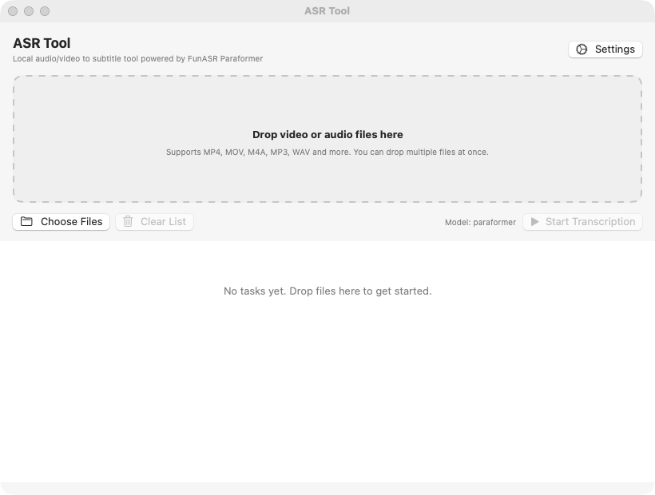

# ASR Tool

A native macOS app that turns video or audio files into SRT / WebVTT subtitles using a local FunASR `paraformer` model.



## Download and Install

Download from GitHub Releases:

- `ASR-Tool-macOS.dmg` (recommended): open it, then drag `ASR Tool.app` onto the `Applications` icon.
- `ASR-Tool-macOS.zip`: unzip it and drag `ASR Tool.app` into your Applications folder.

### macOS says the app is malware / cannot verify the developer

This is macOS Gatekeeper blocking an app that is **not signed and notarized by Apple**. It does not mean the app actually contains malware. This project is built locally with an ad-hoc signature and is not notarized with an Apple Developer ID.

Use any of these methods:

1. Right-click `ASR Tool.app` → Choose **Open** → Click **Open** again in the dialog.
2. Remove the quarantine attribute from the app in Terminal:
   ```bash
   xattr -cr "/Applications/ASR Tool.app"
   ```
   If the app is not in Applications yet, use its actual path instead.
3. If the warning appears when opening the DMG, remove the quarantine attribute first:
   ```bash
   xattr -d com.apple.quarantine ~/Downloads/ASR-Tool-macOS.dmg
   ```

To eliminate this warning completely, the app needs to be signed with an Apple Developer ID and notarized by Apple, which requires a paid developer account.

## Features

- Drag in or choose one or more video/audio files (MP4, MOV, M4A, MP3, WAV, etc.)
- Uses a local FunASR OpenAI-compatible transcription endpoint, with `paraformer` as the default model
- Detects the FunASR environment on first launch and offers one-click install and service startup
- Automatically splits long audio into chunks and stitches timestamps back together
- Exports SRT, VTT, or both
- Saves subtitles next to each source file using the same base name (e.g. `video.mp4` → `video.srt` / `video.vtt`)
- Serial task queue with live progress and error reporting

## Requirements

- macOS 13 or later
- Xcode Command Line Tools (`xcode-select --install`)
- Swift 5.9+
- Python 3 (required by `python3 -m venv`)

LM Studio is no longer required. The app installs the Python virtual environment and dependencies into:

```text
~/Library/Application Support/SubtitleStudio/
```

## Getting Started

1. Build the app:
   ```bash
   chmod +x build.sh
   ./build.sh
   ```
   `ASR Tool.app` will appear in the project root. Double-click to run it.
2. On first launch, the home screen shows the FunASR service status. Click **Install and Start** to create the virtual environment, install `torch / torchaudio / funasr / fastapi / uvicorn / python-multipart`, and start the local service (default: `http://127.0.0.1:8000/v1`).
3. Installation may take a few minutes. Progress and logs are shown in the home banner and in **Settings**.
4. In **Settings**, confirm the API URL and model ID (default: `paraformer`) and choose the output format and language if needed.
5. Drag audio/video files into the window (or click **Choose Files**), then click **Start Transcription**.
6. When finished, click a filename in the task row to reveal the subtitle file in Finder.

## Settings

| Setting | Description |
| --- | --- |
| API URL | FunASR OpenAI-compatible service URL, default `http://127.0.0.1:8000/v1` |
| Model ID | Default `paraformer`, which returns segment timestamps; `sensevoice` does not |
| Output Format | SRT / VTT / Both |
| Language | For example `zh` or `en`; leave empty to auto-detect |
| Chunk Duration | Default 30 seconds; adjust based on your machine |

## Manual Installation (Optional)

To install and start the service yourself:

```bash
python3.11 -m venv ~/.funasr-venv
. ~/.funasr-venv/bin/activate
python -m pip install torch torchaudio funasr fastapi uvicorn python-multipart
funasr-server --host 127.0.0.1 --port 8000 --model paraformer --device cpu
```

Then set the API URL in the app to `http://127.0.0.1:8000/v1`.

## Project Structure

```
.
├── Assets/                     App icon and screenshot assets
├── Sources/SubtitleStudio/
│   ├── App/                    App entry point
│   ├── Models/                 Settings, jobs, and API data models
│   ├── Services/               Audio extraction, chunking, FunASR client, service manager, subtitle writing, job queue
│   ├── Utils/                  WAV utilities
│   └── Views/                  Main window, settings panel, job rows
├── build.sh                    Build and package the .app
└── Package.swift               Swift Package manifest
```

## Troubleshooting

- **"No audio track found in file"**: the source file has no audio track, or its format is not supported by macOS decoding.
- **The home screen says FunASR is not ready**: click **Install and Start**. If it fails, check the log in **Settings**.
- **The transcription result is one long paragraph**: the model may not return timestamps. Set the model ID to `paraformer`.
- **Using a remote FunASR service**: just change the API URL in **Settings**.
